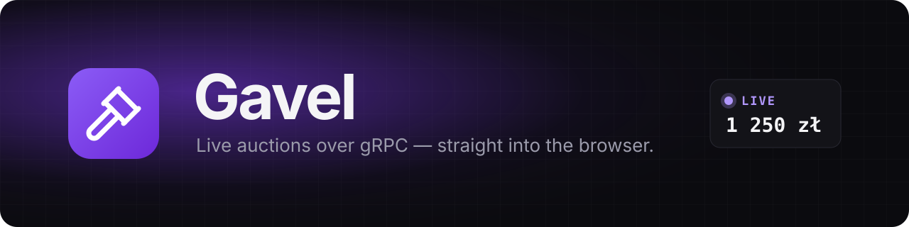
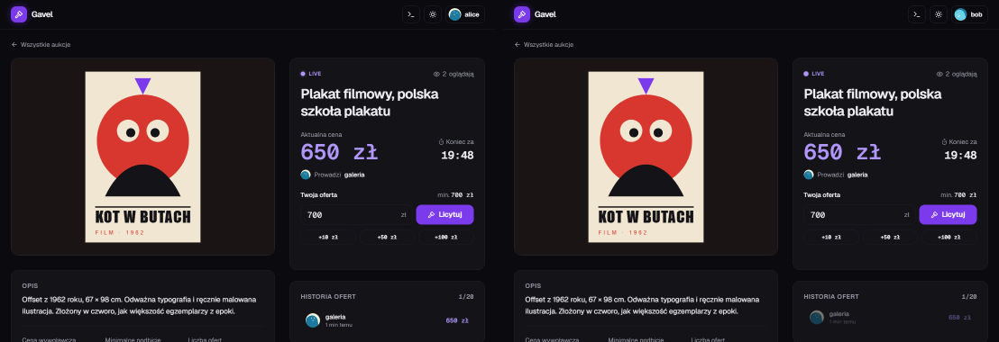
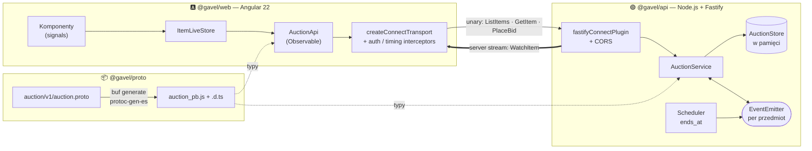
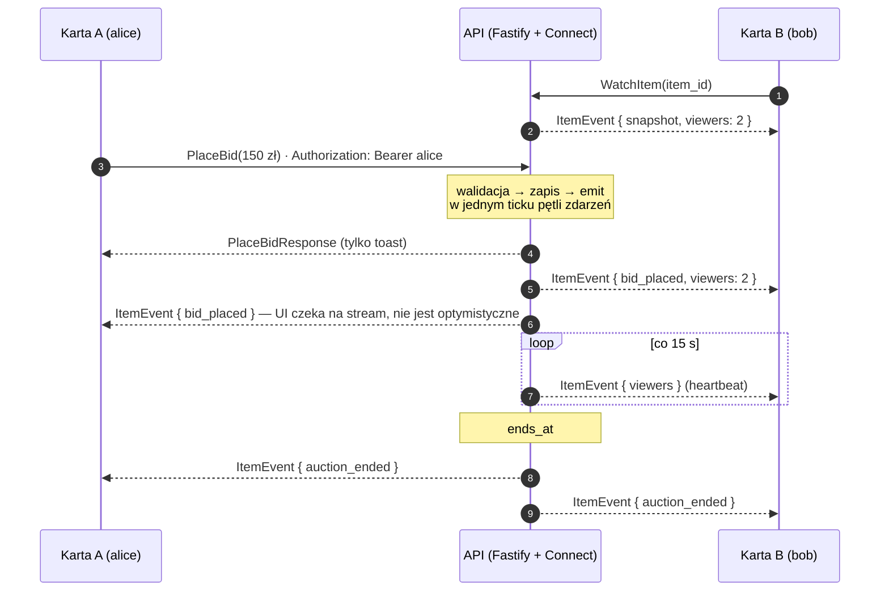
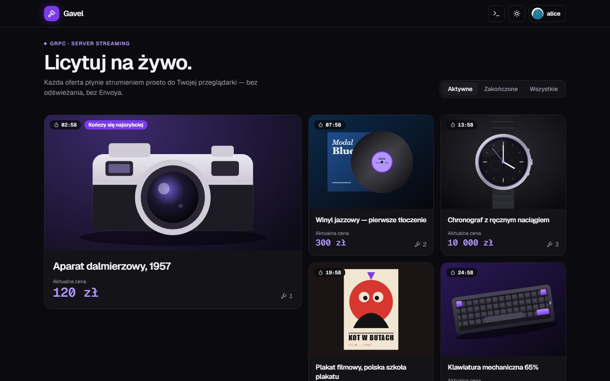
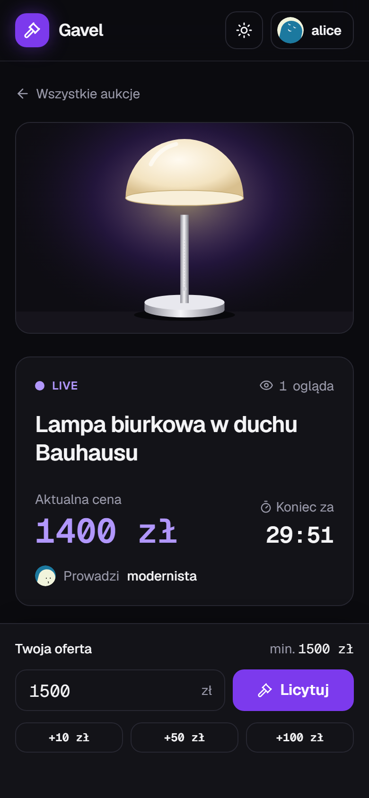
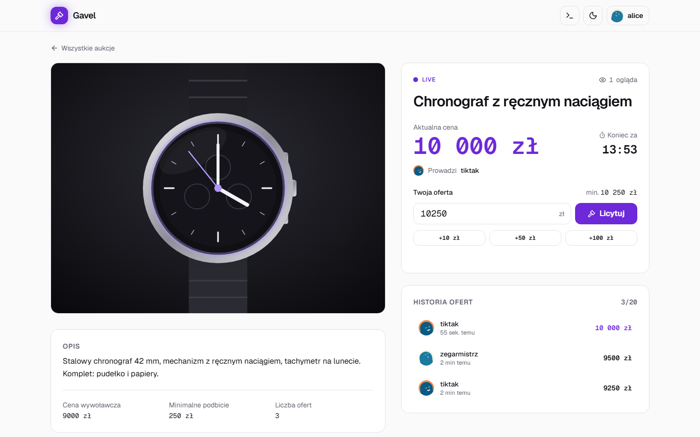
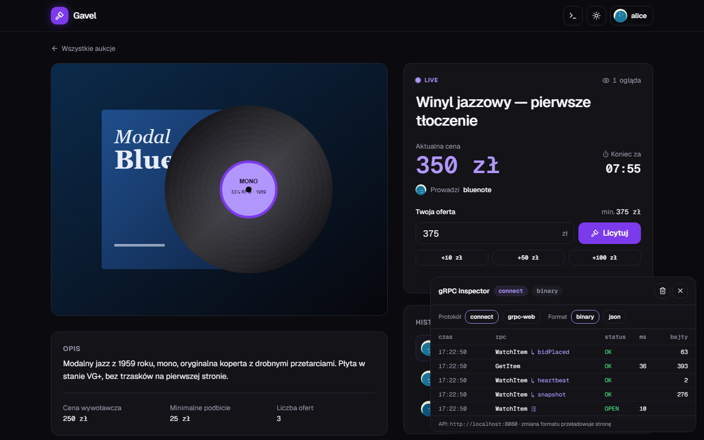

<div align="center">



<h3>Mini aukcja online, w której przeglądarka rozmawia z serwerem <em>wyłącznie</em> przez gRPC.</h3>

<p>
  
  
  
  
  
  
  
  
</p>

<p>
  <a href="#-szybki-start"><b>Szybki start</b></a> ·
  <a href="#-architektura"><b>Architektura</b></a> ·
  <a href="#-kontrakt-api"><b>Kontrakt</b></a> ·
  <a href="#-dlaczego-connect-a-nie-envoy--grpc-web"><b>Connect vs Envoy</b></a> ·
  <a href="#-testy"><b>Testy</b></a>
</p>



<sub>Dwie karty, dwa nicki. Oferta z lewej trafia do prawej strumieniem <code>WatchItem</code> — bez odświeżania, bez pollingu.</sub>

</div>

---

## ✨ Co tu jest do zobaczenia

|                                 |                                                                                                                                                                        |
| ------------------------------- | ---------------------------------------------------------------------------------------------------------------------------------------------------------------------- |
| 📜 **Contract-first**           | Jeden plik [`auction.proto`](packages/proto/auction/v1/auction.proto) jest źródłem typów dla frontu i backendu. Zero ręcznie pisanych DTO — wszystko z `buf generate`. |
| ⚡ **Unary w przeglądarce**     | `ListItems`, `GetItem`, `PlaceBid` — typowane wywołania przez protokół Connect (lub gRPC-Web, jedna linia różnicy).                                                    |
| 📡 **Server streaming na żywo** | `WatchItem` trzyma jedno otwarte połączenie: snapshot, nowe oferty, licznik oglądających, koniec aukcji. Reconnect z backoffem.                                        |
| 🧯 **Błędy gRPC w UI**          | Każdy kod z kontraktu ma komunikat. `FAILED_PRECONDITION` niesie typowany `BidRejectedDetail` z minimalną kwotą.                                                       |
| 🔬 **gRPC „od środka”**         | Panel deweloperski (<kbd>Ctrl</kbd>+<kbd>.</kbd>): ostatnie RPC, czas, rozmiar, binary/JSON, Connect/gRPC-Web.                                                         |

## 🚀 Szybki start

> **Wymagania:** Node.js ≥ 22 (zalecany 24, patrz `.nvmrc`) i pnpm 10 (`corepack enable pnpm`).

```bash
pnpm i        # instaluje zależności i od razu uruchamia `buf generate`
pnpm dev      # API na :8080 + Angular na :4200
```

Otwórz **http://localhost:4200** w dwóch kartach, wybierz dwa różne nicki i licytuj.

<details>
<summary><b>Docker Compose</b></summary>

```bash
docker compose up --build
# web → http://localhost:4200 (nginx proxuje RPC do API), api → http://localhost:8080
SEED_FAST=1 docker compose up --build   # aukcje kończą się w 1–5 min
```

</details>

<details>
<summary><b>Zmienne środowiskowe API</b></summary>

| Zmienna      | Domyślnie               | Opis                                                               |
| ------------ | ----------------------- | ------------------------------------------------------------------ |
| `PORT`       | `8080`                  | Port serwera Fastify                                               |
| `WEB_ORIGIN` | `http://localhost:4200` | Dozwolone originy CORS (po przecinku)                              |
| `SEED_FAST`  | `0`                     | `1` skraca czasy aukcji z 3–30 min do 1–5 min (`pnpm dev:fast`)    |
| `LATENCY_MS` | `0`                     | Sztuczne opóźnienie unary — pokazuje skeletony i blokadę przycisku |
| `RPC_LOG`    | `1`                     | `0` wyłącza log `[rpc] Method 12.3ms`                              |

Front: `apps/web/src/environments/environment.ts` (dev) i `environment.prod.ts` (build produkcyjny, `apiUrl: '/'` — to samo origin przez nginx) — `apiUrl`, `useBinaryFormat`, `protocol`.

</details>

### 🎬 Scenariusz demo

1. Dwie karty z tym samym przedmiotem, dwa różne nicki.
2. W karcie A oferta **150 zł** → w karcie B cena i historia zmieniają się natychmiast.
3. W karcie B oferta **140 zł** → `FAILED_PRECONDITION` i komunikat „Oferta za niska — minimum 160 zł”.
4. Zatrzymaj API → baner **„Łączę ponownie…”**, szara kropka LIVE. Uruchom ponownie → stream wraca ze świeżym snapshotem.
5. Koniec czasu → obie karty pokazują zwycięzcę, a zwycięzca dostaje konfetti 🎉.

> 💡 Do kroku 4 uruchom procesy osobno: `pnpm dev:api` i `pnpm dev:web` w dwóch terminalach. `pnpm dev:fast` przyspiesza krok 5.

## 🏛 Architektura

Front i backend łączy **wyłącznie** pakiet wygenerowany z `.proto`. Przez sieć idą wywołania unary oraz jeden strumień zdarzeń z serwera do przeglądarki.



Jak oferta z karty A trafia do karty B:



<details>
<summary><b>Struktura repozytorium</b></summary>

```text
gavel/
├── packages/proto/              @gavel/proto
│   ├── auction/v1/auction.proto   ← jedyne źródło prawdy
│   └── gen/                       ← wynik `buf generate` (gitignored)
├── apps/api/                    @gavel/api — Fastify + Connect
│   └── src/
│       ├── main.ts / app.ts       Fastify, fastifyConnectPlugin, CORS
│       ├── routes.ts              router.service(AuctionService, impl)
│       ├── auction.service.ts     4 RPC (WatchItem jako async function*)
│       ├── auction.store.ts       Map<itemId, Item>, Map<itemId, Bid[]>, seed
│       ├── auction.events.ts      EventEmitter: bid:<id>, ended:<id>, viewers:<id>
│       ├── auth.interceptor.ts    Bearer <nick> → contextValues, LATENCY_MS
│       ├── rate-limiter.ts        5 ofert / s / nick
│       └── scheduler.ts           setTimeout na ends_at
├── apps/web/                    @gavel/web — Angular 22 (standalone, signals, zoneless)
│   └── src/app/
│       ├── core/grpc/             transport, token klienta, fromStream(), toUiError(), interceptory
│       ├── data-access/           AuctionApi, ItemLiveStore
│       ├── features/              nickname · item-list · item-detail · bid-form
│       └── shared/ui/             countdown, money pipe, animated price, sparkline, dev panel…
├── e2e/                         Playwright: dwa konteksty przeglądarki, restart serwera
├── buf.yaml · buf.gen.yaml
├── docker-compose.yml
└── .github/workflows/ci.yml
```

</details>

## 📜 Kontrakt API

Jeden serwis, cztery RPC — pełny plik: [`packages/proto/auction/v1/auction.proto`](packages/proto/auction/v1/auction.proto).

```protobuf
service AuctionService {
  rpc ListItems(ListItemsRequest) returns (ListItemsResponse);   // unary
  rpc GetItem(GetItemRequest)     returns (GetItemResponse);     // unary
  rpc PlaceBid(PlaceBidRequest)   returns (PlaceBidResponse);    // unary
  rpc WatchItem(WatchItemRequest) returns (stream ItemEvent);    // server streaming
}

message ItemEvent {
  oneof event {
    Item snapshot = 1;       // pierwsze zdarzenie po podłączeniu
    Bid bid_placed = 2;
    Item auction_ended = 3;
  }
  int32 viewers = 10;        // ilu klientów ogląda przedmiot
}
```

Pieniądze to `int64 amount_minor` (grosze) — w TypeScript `bigint`, bez floatów. Wersja `v1` w pakiecie pozwala ewoluować kontrakt, a `buf breaking` w CI pilnuje, żeby nie złamać klientów.

| Kod gRPC              | Kiedy                                                          | Komunikat w UI                                         |
| --------------------- | -------------------------------------------------------------- | ------------------------------------------------------ |
| `INVALID_ARGUMENT`    | kwota ≤ 0, zła waluta, puste `item_id`                         | „Nieprawidłowa kwota”                                  |
| `NOT_FOUND`           | nieznany przedmiot                                             | „Ta aukcja nie istnieje”                               |
| `FAILED_PRECONDITION` | oferta < `current_price + min_increment` lub aukcja zakończona | „Oferta za niska — minimum X zł” / „Aukcja zakończona” |
| `UNAUTHENTICATED`     | brak `Authorization` przy `PlaceBid`                           | przekierowanie do wyboru nicku                         |
| `RESOURCE_EXHAUSTED`  | > 5 ofert na sekundę od jednego nicku                          | „Zwolnij — za dużo ofert”                              |
| `UNAVAILABLE`         | serwer nieosiągalny, zerwany stream                            | baner „Łączę ponownie…”                                |

## 🧠 Jak to działa

<table>
<tr>
<td width="50%" valign="top">

**Backend**

- **`WatchItem` to `async function*`.** Najpierw `yield` snapshotu, potem pętla po zdarzeniach z emitera. Rozłączenie klienta → `ctx.signal` kończy pętlę, `finally` zdejmuje listenery i zmniejsza licznik oglądających.
- **Jeden tick.** `PlaceBid` waliduje, zapisuje i emituje synchronicznie — dwie równoległe oferty nie wygrają tej samej ceny (jest na to test).
- **Heartbeat co 15 s** z samym `viewers`, żeby proxy i przeglądarka nie zamknęły bezczynnego połączenia.
- **Autoryzacja „na niby”.** Interceptor czyta `Bearer <nick>` i wkłada go do `contextValues`. Odczyt katalogu jest anonimowy.

</td>
<td width="50%" valign="top">

**Frontend**

- **`fromStream()`** zamienia `AsyncIterable` na `Observable`; `unsubscribe()` wywołuje `abort()`, więc wyjście z widoku zamyka stream na serwerze.
- **`ItemLiveStore`** (signals: `item`, `bids`, `viewers`, `connection`) obsługuje `oneof` przez `switch (event.event.case)` — TypeScript wymusza wszystkie przypadki.
- **Reconnect:** `retry()` z backoffem 1 s → 2 s → 4 s … 30 s, tylko dla `UNAVAILABLE`/`UNKNOWN`. Pierwszy snapshot po powrocie nadpisuje stan.
- **Świadomie bez optymistycznego UI.** Odpowiedź `PlaceBid` to tylko toast — cena zmienia się dopiero, gdy przyjdzie `bid_placed`. Stream jest jedynym źródłem prawdy.

</td>
</tr>
</table>

## 🤔 Dlaczego Connect, a nie Envoy + gRPC-Web

Przeglądarka nie potrafi mówić „czystym” gRPC (HTTP/2 z trailerami), więc klasycznie stawia się **Envoy** jako tłumacza gRPC-Web ↔ gRPC. Gavel tego nie potrzebuje:

|                                    | Envoy + gRPC-Web                           | **Connect (ten projekt)**                                                            |
| ---------------------------------- | ------------------------------------------ | ------------------------------------------------------------------------------------ |
| Elementy infrastruktury            | serwer gRPC + Envoy + konfiguracja filtrów | **jeden serwer** Fastify z `@connectrpc/connect-fastify`                             |
| Protokoły obsługiwane przez serwer | gRPC (gRPC-Web przez proxy)                | **gRPC, gRPC-Web i Connect** natywnie, na tym samym porcie                           |
| Debugowanie w DevTools             | binarne ramki base64                       | Connect + JSON jest czytelny w zakładce Network (przełącznik w panelu deweloperskim) |
| `curl`                             | trudny                                     | `curl -H 'Content-Type: application/json' -d '{…}' …/PlaceBid`                       |
| Klient w przeglądarce              | `grpc-web` + osobny generator              | `@connectrpc/connect-web` + typy z `protoc-gen-es`                                   |
| Zmiana protokołu po stronie frontu | inny klient                                | **jedna linia:** `createConnectTransport` ↔ `createGrpcWebTransport`                 |

Test integracyjny API uruchamia ten sam scenariusz streamu przez **Connect i gRPC-Web** — oba działają bez proxy.

### Dlaczego nie ma client ani bidirectional streamingu?

`fetch()` w przeglądarce nie daje pełnego dupleksu, a strumieniowe ciało żądania (`duplex: 'half'`) działa tylko w części przeglądarek i tylko po HTTP/2. Dlatego `@connectrpc/connect-web` — zarówno dla Connect, jak i gRPC-Web — obsługuje wyłącznie **unary** i **server streaming**. To ograniczenie platformy, nie biblioteki: `PlaceBid` jest unary, a wszystko „na żywo” płynie jednym strumieniem z serwera. Serwer Node obsłużyłby wszystkie cztery tryby dla klientów spoza przeglądarki.

## 🎨 Wygląd

Dark-first, jedna barwa akcentu (elektryczny fiolet) tylko dla ceny, przycisku „Licytuj” i kropki LIVE. Geist + Geist Mono z `tabular-nums`, żeby cyfry nie skakały.

<table>
<tr>
<td width="62%"></td>
<td rowspan="2" width="38%"></td>
</tr>
<tr>
<td></td>
</tr>
</table>

**Mikrointerakcje, które „sprzedają” streaming:**

- nowa oferta wjeżdża na górę historii i podświetla się na 1,5 s,
- cena przelicza się licznikiem od starej do nowej wartości (~400 ms), a przy przebiciu — czerwony błysk i toast „Ktoś Cię przebił”,
- pulsująca kropka **LIVE**, szara przy reconnect,
- odliczanie zmienia kolor w ostatniej minucie i przyspiesza puls w ostatnich 10 s,
- View Transitions: zdjęcie karty płynnie rośnie do nagłówka szczegółów,
- konfetti tylko u zwycięzcy, skeletony zamiast spinnerów, loader w przycisku podczas `PlaceBid`,
- na telefonie formularz jako przyklejony dolny pasek z „+10 / +50 / +100 zł”.

**Dostępność:** historia ofert w `aria-live="polite"`, `prefers-reduced-motion` wyłącza liczniki, konfetti i View Transitions, pełna obsługa klawiaturą, reguły `angular-eslint` dla dostępności szablonów.

### 🔬 Panel deweloperski — <kbd>Ctrl</kbd>+<kbd>.</kbd>



Każde RPC i każde zdarzenie ze streamu: nazwa, `oneof` case, status, czas, rozmiar payloadu. Przełączniki **Connect ↔ gRPC-Web** i **binary ↔ JSON** (zapisywane w `localStorage`) pozwalają porównać ruch w zakładce Network bez dotykania kodu.

## 🧪 Testy

| Warstwa          | Narzędzie                                                    | Co sprawdza                                                                                                                                       |
| ---------------- | ------------------------------------------------------------ | ------------------------------------------------------------------------------------------------------------------------------------------------- |
| API · unit       | Vitest + `createRouterTransport`                             | każdy kod błędu `PlaceBid`, typowany `BidRejectedDetail`, rate limit, wyścig dwóch ofert, scheduler                                               |
| API · integracja | Vitest + prawdziwy serwer na losowym porcie + `connect-node` | subskrypcja, oferta z drugiego klienta, `bid_placed`, przerwanie i licznik oglądających — **przez Connect i gRPC-Web**                            |
| Web · unit       | Vitest (`ng test`)                                           | `fromStream()` (emisja, błąd, `abort`), `toUiError()`, `ItemLiveStore` z transportem w pamięci (snapshot, outbid, koniec, `NOT_FOUND`, reconnect) |
| Web · komponent  | Angular Testing Library                                      | `BidForm`: prefill minimum, blokada przycisku, komunikaty błędów, przekierowanie bez nicku                                                        |
| E2E              | Playwright                                                   | dwa konteksty przeglądarki (oferta w jednym, asercja w drugim < 1,5 s), ekran 404, reconnect po restarcie serwera                                 |

```bash
pnpm test          # API + web
pnpm e2e           # Playwright (pierwszy raz: pnpm -F @gavel/e2e install-browsers)
pnpm lint          # ESLint + angular-eslint
pnpm buf:lint      # lint kontraktu
pnpm buf:breaking  # zgodność wsteczna względem main
```

**CI** ([`.github/workflows/ci.yml`](.github/workflows/ci.yml)) na każdym PR: lint → `buf lint` / `buf breaking` → typecheck → testy → build → E2E. Lokalnie Husky + lint-staged formatują i lintują zmienione pliki przed commitem.

> Zrzuty i GIF w tym README generuje Playwright: `pnpm -F @gavel/e2e docs`.

## 🧰 Stack

| Warstwa  | Narzędzia                                                                                                                                            |
| -------- | ---------------------------------------------------------------------------------------------------------------------------------------------------- |
| Kontrakt | Buf CLI (`lint`, `breaking`, `generate`), `protoc-gen-es` (protobuf-es v2)                                                                           |
| Backend  | Node.js 24, Fastify 5, `@connectrpc/connect-fastify`, `@connectrpc/connect-node`, `@fastify/cors` + listy nagłówków z `cors` z `@connectrpc/connect` |
| Frontend | Angular 22 (standalone, signals, zoneless, Signal Forms), `@connectrpc/connect-web`, RxJS                                                            |
| UI       | Tailwind CSS v4 (`@theme`), komponenty w stylu shadcn/spartan-helm trzymane w repo, `ngx-sonner`, `@lucide/angular`, DiceBear, `canvas-confetti`     |
| Jakość   | Vitest, Angular Testing Library, Playwright, ESLint + angular-eslint, Prettier, Husky + lint-staged                                                  |
| Monorepo | pnpm workspaces, Docker Compose, GitHub Actions                                                                                                      |

<details>
<summary><b>Decyzje i odstępstwa od specyfikacji</b></summary>

- **Komponenty UI:** zamiast instalować spartan/ui (którego generator zakłada Nx) przyciski, karty, badge i skeletony są napisane w stylu spartan-helm bezpośrednio w `styles.css`; toasty to `ngx-sonner` — ten sam, którego używa spartan.
- **Minimum oferty sprawdza tylko serwer.** Formularz nie blokuje zbyt niskiej kwoty po stronie klienta — inaczej krok 3 demo nigdy nie pokazałby `FAILED_PRECONDITION` z `BidRejectedDetail`.
- **Pierwsza oferta** też musi wynosić co najmniej `current_price + min_increment` (zgodnie z tabelą błędów).
- **`UNAUTHENTICATED` tylko dla `PlaceBid`** — lista i podgląd aukcji działają bez nicku (US-2, US-3).
- **Zdarzenia emitera** mają kanały `bid:<id>`, `ended:<id>` oraz dodatkowy `viewers:<id>` dla licznika oglądających.

</details>

## 🗺 Rozszerzenia

- [ ] Deployment: API na Fly.io / Render, front na Vercel / Netlify z publicznym demo
- [ ] Angular SSR z unary po stronie serwera (`connect-node`) i transfer state
- [ ] Drugi klient w React z tym samym `@gavel/proto`
- [ ] PostgreSQL + Drizzle i Redis pub/sub zamiast `EventEmitter` (wiele instancji API)
- [ ] Widget aukcji jako remote w micro-frontendowym pulpicie

---

<div align="center">
<sub>Zbudowane z 🔨 i jednym plikiem <code>.proto</code>.</sub>
</div>
